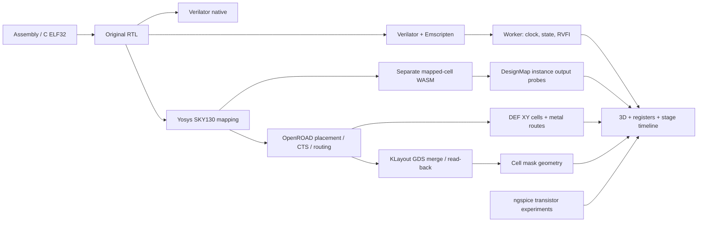

# CPU LAB architecture and execution contract

## Implemented processors

| Model | ISA | Instruction flow | Data path |
|---|---|---|---|
| RV32I | Base 32-bit integer ISA, no compressed instructions | IF → ID → EX → MEM → WB; one instruction at a time | 32-bit ALU, 32 integer registers, x0 reads zero |
| RV32IM | RV32I plus multiply/divide | Five stages with valid bits, MEM/WB forwarding, blocking memory backpressure, EX branch resolution and younger-instruction flush | Same integer path plus synthesizable M arithmetic |

Both are original SystemVerilog designs. RISC-V specifies architectural effects; it does not prescribe this pipeline or floorplan. The current M implementation computes multiplication/division combinationally and imposes EX occupancy of four cycles for multiplication and 32 for division/remainder. It is **not** an iterative divider. This choice appears in the physical area and timing reports. A future iterative unit is an architectural experiment, not a measured result in this design.

The base instruction target includes LUI, AUIPC, JAL/JALR, six branches, five loads, three stores, nine immediate ALU operations, ten register ALU operations, FENCE, ECALL and EBREAK. RV32IM adds eight M operations. Zicsr, privileged architecture, compressed instructions, interrupts, virtual memory and Linux boot are outside this bare-metal target. FENCE conservatively orders this already blocking memory system and ignores reserved rs1/rd fields, as required by the [RV32I specification](https://docs.riscv.org/reference/isa/v20260120/unpriv/rv32.html).

## Memory and external interface

| Address | Size | Meaning |
|---|---|---|
| 0x00000000 | 64 KiB | Little-endian program memory, entry PC = 0, read-only during execution |
| 0x10000000 | 64 KiB | Little-endian data memory |
| 0x20000000 | 32-bit port | Write lowest byte to UART; reads return zero |
| 0x20000004 | 32-bit port | GPIO output register; reads return current value |

Instruction interface: `i_req`, `i_addr`, `i_ready`, `i_data`, `i_fault`.
Data interface: `d_req`, `d_write`, `d_addr`, `d_wdata`, `d_size`, `d_ready`, `d_rdata`, `d_fault`.
A request transfers on the rising edge when req && ready. Uncompleted requests retain address, data, size and direction. Addresses are byte addresses; d_rdata is the containing 32-bit word. CPU lane selection/sign extension handles byte and halfword reads. d_wdata contains the unshifted store value; the execution environment writes the indicated addressed bytes. `d_size` uses the load/store funct3 encoding.

The local execution environment terminates on ECALL/EBREAK, unsupported instructions, misalignment and access faults. `trap_cause` is a debug/EEI status, not an implemented privileged mcause CSR: code 1 groups instruction alignment/access failures; 2 illegal, 3 EBREAK, 4/6 misaligned load/store, 5/7 load/store access fault, 11 ECALL. Trap PC and effective address are retained; younger instructions must not write registers or memory after the fault. No software trap handler runs.

## Cache experiment

`lab_soc` wraps the CPU in actual synthesizable I/D cache RTL. Each cache is direct mapped, 1 KiB, 64 × 16-byte lines with four 32-bit refill transfers. D cache is write-through, no write allocation; byte lanes merge on a hit. UART/GPIO bypass caching. Pipeline cache enable is configurable; the multicycle comparison is cacheless. Configured backing-memory latency is 1–20 cycles per request, not a claim about silicon latency.

The physical boundary `physical_core` omits observation ports and caches. This prevents debug instrumentation and experimental memories from inflating the floorplan. Gate-to-RTL comparison therefore uses cache disabled.

## Digital-twin data path

Architecture blocks, operand paths and the full-adder lesson are explanatory geometry. Their displayed values come from RTL. Physical cells and metal XY coordinates come from generated DEF/LEF. Selected cell masks come from SKY130 GDS. GDS is two-dimensional mask geometry; vertical elevations in the 3D viewer are an illustrative exploded stack, not fabricated process thickness.

Mapped gate simulation imports the same SKY130 liberty Boolean/sequential functions. It has no SDF delay. Physical timing comes from OpenROAD STA, not browser animation speed. DesignMap ties instance/pin probes to retained RTL net aliases. Placement cells inserted by resizing/CTS/tap insertion without a corresponding probe remain gray/unknown. A mapped-netlist hash mismatch or cycle mismatch disables coloring. Multiple output probes are blue for all zero, teal for all one and purple for mixed values. Unknown values stay gray. Browser metal routes are DEF centerlines; native GDS preserves full wire widths and via/cut geometry.

## Debug and replay

The worker owns each WASM model. UI commands advance complete rising edges. Run emits bounded batches; pause and new seek/load operations invalidate previous work. Replay resets memories/peripherals and re-executes the loaded binary to a selected cycle. It does not reverse arbitrary physical time. Trace history keeps the latest 512 frames; experiment export stores the binary segments, config and replay cycle, including ELF input. Trace export stores the retained signal frames.

PC breakpoints stop when the instruction reaches ID. They are pipeline observation breakpoints and do not claim to prevent all older effects. Memory watchpoints stop on an observed CPU data request. C sample DWARF maps instruction addresses to source lines; assembler source mappings cover emitted instruction starts.

## Verification scope

- Native/WASM equality: cycle-by-cycle CPU frames, including actual cache RTL.
- Spike: independent upstream processor with the same bare-metal EEI, compared at retirement, plus final memory/peripherals and seeded arithmetic sequences.
- riscv-formal: upstream RV32I instruction checks for both control variants, bounded at cycle 18 with arbitrary ready/data and no access faults. M arithmetic is excluded from these formal jobs and checked against Spike. This is not unbounded induction or full privileged-architecture proof.
- Additional bounded invariants: one RV32I pipeline job (M disabled), x0, halted quiescence, register hold and stable stalled requests with arbitrary ready/fault/data; depth 18.
- Mapped-cell model: cacheless architectural state must match RTL on every cycle, then memory and trap effects match.
- OpenROAD: generated placement, CTS, global/detailed routing and measured reports. GDS merge/read-back is separate from fabrication signoff. No foundry tapeout, full process LVS/DRC, silicon measurements, power claims or FPGA acceptance are inferred.

Every final claim must point to a fresh test/report and matching source hashes. Browser viewport tests are not physical tablet acceptance.
